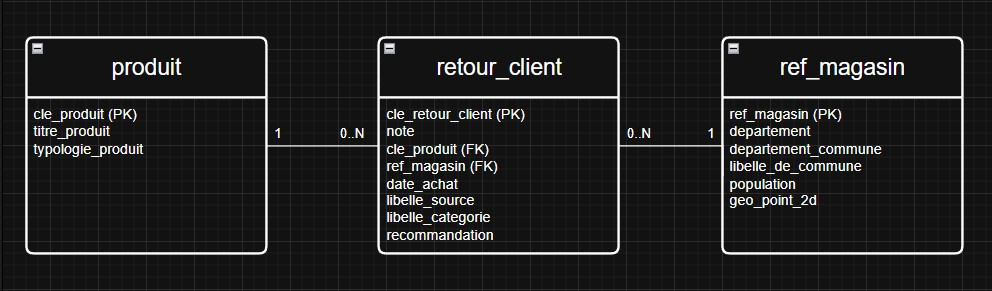

# Analyse de la satisfaction client — SQL & SQLite

**Projet 5 — Parcours Business Intelligence Analyst | OpenClassrooms**

**Technologies :** SQL · SQLite · SQLiteStudio · Excel · PowerPoint

---

## 1. Présentation du projet

Ce projet a été réalisé dans le cadre de ma formation **Business Intelligence Analyst chez OpenClassrooms**.

Il repose sur une étude de cas consacrée à **BestMarket**, une entreprise fictive souhaitant améliorer l'expérience de ses clients grâce à l'exploitation de leurs retours et évaluations.

Les données proviennent de plusieurs canaux de communication : réseaux sociaux, téléphone, campagnes emailing et application mobile.

L'objectif est de structurer ces informations dans une base relationnelle, d'en contrôler la qualité et de réaliser des analyses SQL afin de produire des indicateurs exploitables pour la prise de décision.

Le projet associe trois dimensions :

- **Technique :** structuration, interrogation et contrôle des données avec SQL.
- **Analytique :** calcul d'indicateurs et analyse de la satisfaction client.
- **Métier :** identification des axes d'amélioration et formulation de recommandations.

## 2. Objectifs métier

Le service client et la direction souhaitent disposer d'une vision fiable et exploitable de la satisfaction client.

Les principaux objectifs sont :

- Centraliser et exploiter les retours clients.
- Identifier les principales causes d'insatisfaction.
- Comparer les performances des magasins et des catégories de produits.
- Analyser les différences de satisfaction entre les canaux de communication.
- Mesurer la satisfaction à travers les notes et le Net Promoter Score (NPS).
- Identifier les magasins dont la satisfaction est inférieure à la moyenne.
- Proposer des actions d'amélioration de l'expérience client et de fidélisation.

Ces objectifs ont été formalisés dans un document d'expression des besoins.

## 3. Technologies et compétences mobilisées

| Technologie / méthode | Utilisation dans le projet |
|---|---|
| SQL | Extraction, jointures, agrégations et analyses métier |
| SQLite | Stockage et exploitation d'une base relationnelle |
| SQLiteStudio | Exploration de la base et exécution des requêtes |
| Contrôle qualité | Recherche de doublons, NULL, incohérences et références orphelines |
| Modélisation relationnelle | Compréhension des relations entre les tables |
| Excel | Dictionnaire de données |
| PowerPoint | Présentation des analyses et recommandations |

**Principales notions SQL utilisées :**

`SELECT` · `WHERE` · `JOIN` · `LEFT JOIN` · `GROUP BY` · `HAVING` · `ORDER BY` · `AVG` · `COUNT` · `SUM` · `CASE WHEN` · `strftime` · Sous-requêtes

## 4. Modèle de données

La base SQLite est composée de trois tables principales :

| Table | Description | Nombre de lignes |
|---|---|---:|
| `retour_client` | Avis, notes et recommandations des clients | 3 000 |
| `produit` | Référentiel des produits | 145 |
| `ref_magasin` | Référentiel des magasins | 84 |

La table `retour_client` constitue la table centrale de l'analyse.

Elle contient notamment les informations permettant d'étudier les notes, les produits concernés, les magasins, les catégories de retour et les canaux de communication.

Les relations avec les référentiels `produit` et `ref_magasin` permettent d'enrichir les analyses.

### Schéma relationnel

Le schéma illustre l'organisation des tables et leurs relations logiques.

Les contrôles SQL permettent également de rechercher d'éventuelles références orphelines.

## 5. Travaux réalisés

### 5.1. Analyse des besoins

Rédaction d'une expression des besoins précisant :

- Le contexte de l'entreprise.
- Les attentes du service client et de la direction.
- Les indicateurs attendus.
- Les règles de calcul.
- Les exigences de qualité des données.
- Les recommandations métier attendues.

Cette phase permet de relier les traitements techniques aux objectifs décisionnels.

### 5.2. Structuration et documentation des données

Travail sur la base relationnelle SQLite et ses trois tables principales.

Les travaux comprennent :

- L'exploration des tables et des colonnes.
- La création du référentiel magasins.
- L'identification des relations entre les tables.
- La documentation des champs dans un dictionnaire de données.
- La production d'un schéma relationnel.

### 5.3. Contrôle de la qualité des données

Réalisation de requêtes SQL pour identifier les anomalies potentielles.

| Contrôle | Objectif |
|---|---|
| Doublons | Identifier plusieurs enregistrements portant le même identifiant |
| Valeurs NULL | Repérer les données manquantes dans les champs contrôlés |
| Références orphelines | Identifier les retours associés à des produits ou magasins absents |
| Cohérence des notes | Vérifier que les notes sont comprises entre 0 et 10 |
| Recommandations | Examiner le codage des réponses utilisées pour les indicateurs |

Les contrôles sont documentés dans :

[**Consulter les requêtes de contrôle qualité**](sql/02_controles_qualite.sql)

### 5.4. Analyses métier SQL

Le projet comporte **17 questions d'analyse métier**, accompagnées de requêtes SQL.

| Analyse | Objectif |
|---|---|
| Q1 | Étudier les catégories de retours et le volume lié à la livraison |
| Q2 | Analyser les notes des produits TV issues des réseaux sociaux |
| Q3 | Comparer les notes moyennes par typologie de produit |
| Q4 | Identifier les cinq magasins présentant les meilleures moyennes |
| Q5 | Rechercher les magasins comptabilisant plus de 12 retours drive |
| Q6 | Comparer la satisfaction moyenne par département |
| Q7 | Analyser la satisfaction SAV par typologie de produit |
| Q8 | Calculer la note moyenne liée aux produits Boissons |
| Q9 | Étudier la satisfaction en magasin selon le jour de la semaine |
| Q10 | Analyser les volumes mensuels des retours SAV |
| Q11 | Calculer le taux de recommandation |
| Q12 | Identifier les magasins dont la note est inférieure à la moyenne générale |
| Q13 | Comparer les moyennes du premier et du deuxième trimestre 2021 |
| Q14 | Calculer le NPS global |
| Q15 | Calculer le NPS par source de retour |
| Q16 | Mesurer le volume de retours par canal |
| Q17 | Identifier les cinq magasins ayant le plus de retours |

Les analyses reposent notamment sur les jointures, les regroupements, les fonctions d'agrégation et les calculs conditionnels.

[**Consulter les 17 analyses métier SQL**](sql/03_analyses_metier.sql)

## 6. Indicateurs de satisfaction

### Note moyenne

La note moyenne permet de comparer la satisfaction selon différents axes : magasins, départements, typologies de produits ou catégories de retours.

Elle est obtenue en divisant la somme des notes par le nombre de notes renseignées.

### Taux de recommandation

Cet indicateur mesure la proportion de réponses positives à la question de recommandation.

Il est calculé à partir du champ `recommandation`, après vérification de son codage.

### Net Promoter Score — NPS

Le NPS est utilisé pour apprécier la propension des clients à recommander l'entreprise.

Les réponses sont réparties en trois catégories :

| Catégorie | Notes |
|---|---|
| Promoteurs | 9 à 10 |
| Passifs | 7 à 8 |
| Détracteurs | 0 à 6 |

**NPS = % de promoteurs − % de détracteurs**

Le score varie de -100 à +100.

Deux analyses ont été réalisées :

- NPS global.
- NPS par source de retour client.

Ces indicateurs permettent d'étudier les différences de satisfaction entre les canaux.

## 7. Résultats et recommandations métier

Le projet a permis de structurer l'analyse des retours clients autour de plusieurs dimensions :

- Satisfaction selon les magasins.
- Performance des typologies de produits.
- Satisfaction du service après-vente.
- Répartition des retours selon les canaux.
- Évolution temporelle de certains indicateurs.
- Niveau de recommandation et NPS.

Les analyses ont servi de support à la formulation de recommandations destinées à l'entreprise.

### Recommandations proposées

**Amélioration du SAV :** renforcer le suivi des retours après-vente et examiner les typologies de produits présentant des niveaux de satisfaction plus faibles.

**Suivi des magasins :** identifier les magasins situés sous la moyenne générale afin de prioriser les investigations.

**Pilotage de la satisfaction :** mettre en place un suivi régulier du NPS et comparer ses évolutions entre les canaux.

**Fidélisation :** développer des actions ciblées à partir des principaux irritants identifiés.

Les résultats détaillés et leur restitution figurent dans la présentation finale du projet.

## 8. Livrables du projet

### Scripts SQL

| Fichier | Description |
|---|---|
| [01_creation_base.sql](sql/01_creation_base.sql) | Structure non destructive des tables SQLite |
| [02_controles_qualite.sql](sql/02_controles_qualite.sql) | Contrôles de qualité et de cohérence |
| [03_analyses_metier.sql](sql/03_analyses_metier.sql) | Requêtes correspondant aux 17 analyses métier |
| [CustomerDataFeedback.sql](sql/CustomerDataFeedback.sql) | Script original d'initialisation et de chargement |

### Données

| Fichier | Description |
|---|---|
| [CustomerDataFeedback.db](data/CustomerDataFeedback.db) | Base SQLite utilisée pour le projet |
| [Référentiel magasins](data/ref_magasin+(1).csv) | Données de référence des magasins |

### Documentation

| Document | Description |
|---|---|
| [Expression des besoins](documentation/Expression_besoin_template.docx.odt) | Formalisation
